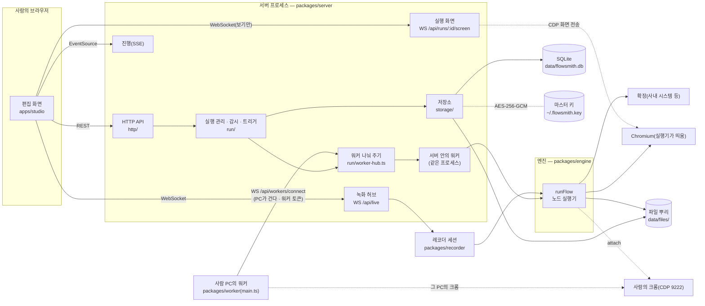
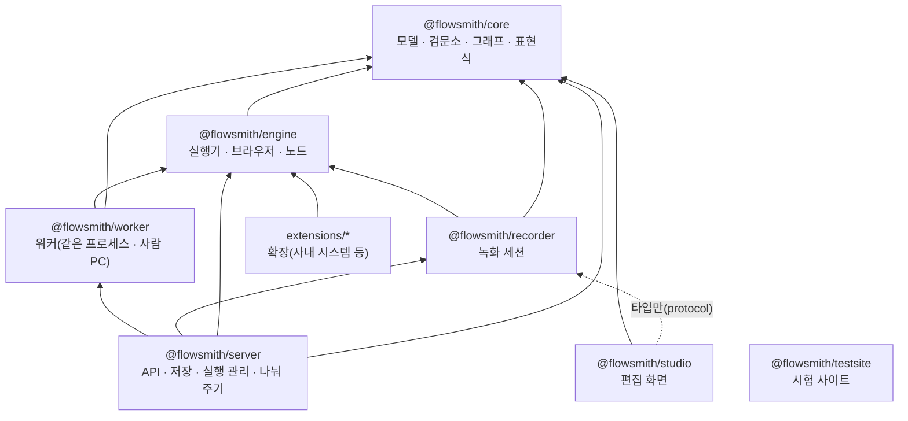
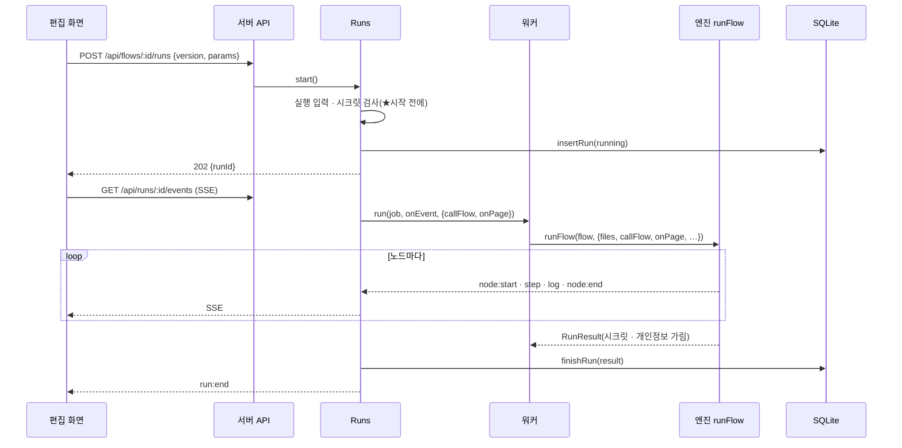
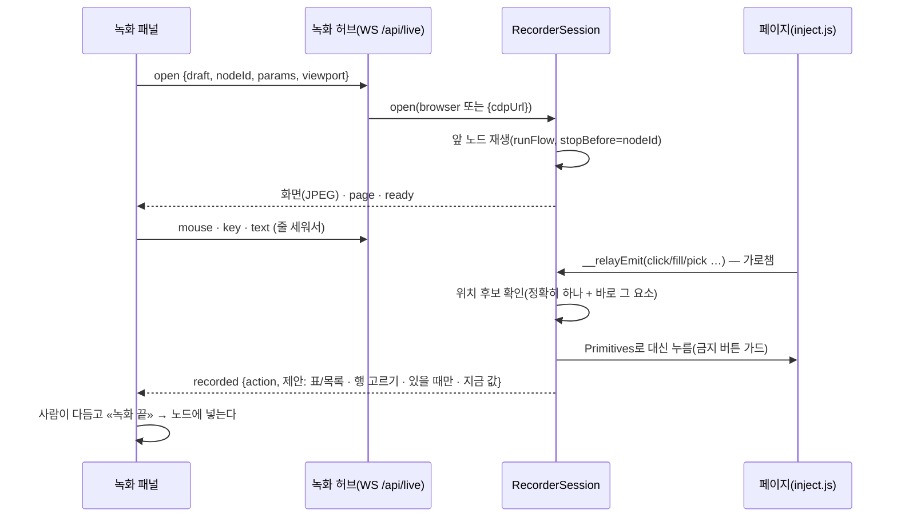

# Flowsmith — 시스템 구조

웹 페이지에서 하는 일을 **노드**로, 데이터 흐름을 **엣지**로 그린 비순환 그래프(플로우)를 만들고 · 게시하고 · 돌리는 웹 자동화 플로우 엔진.
이 문서는 **지금 코드가 어떻게 나뉘어 있고 어떻게 맞물려 도는지**를 적는다.
결정의 이유와 역사는 [PLAN.md](PLAN.md), 지금까지 만든 기능 목록은 [FEATURES.md](FEATURES.md)에 있다.

- 기준 시점: 2026-10-16
- 실행 환경: Node 24(빌드 없음 — `.ts`를 그대로 돈다) · pnpm 워크스페이스 · Playwright 1.63 · SQLite(`node:sqlite`) · React 19 + Vite

---

## 1. 한눈에



| 계층 | 하는 일 |
|---|---|
| **편집 화면**(apps/studio) | 캔버스에서 플로우를 그리고, 녹화하고, 돌리고, 결과 · 감시 · 트리거 · 파일을 본다 |
| **서버**(packages/server) | 플로우 · 버전 · 시크릿 · 실행 기록 저장, 실행 시작 · 진행 중계, 녹화 세션 · 실행 화면 중계, 일정 · 웹훅 · 변경 감시 |
| **워커**(packages/worker) | 실행을 엔진에 넘긴다. 서버 안(같은 프로세스) 또는 **사람 PC**의 워커 프로그램 — 서버의 WorkerHub가 플로우의 «어디서 돌리나»대로 나눠 준다(젠킨스의 노드처럼) |
| **엔진**(packages/engine) | 플로우를 노드 순서대로 돌린다. 웹페이지 노드는 Playwright로 브라우저를 다룬다 |
| **레코더**(packages/recorder) | 라이브 페이지 위에서 사람이 한 일을 동작으로 바꾼다(녹화가 곧 재생 시험) |
| **코어**(packages/core) | 매니페스트 모델 · 검문소(parseFlow) · 그래프 컴파일 · 표현식 · 조건 · 실행 상태 — **순수**(입출력 없음) |

---

## 2. 저장소 구성과 의존 방향



- 화살표는 «가져다 쓴다». **core는 아무것도 모른다** — 브라우저도, 파일도, DB도. 그래서 편집 화면(브라우저)과 엔진(Node)이 같은 모델 · 같은 검문소를 쓴다.
- 편집 화면은 레코더의 **타입만**(`@flowsmith/recorder/protocol`) 가져간다 — 녹화 메시지의 약속.
- 확장은 엔진의 `Extension` 꼴만 맞추면 된다(서버가 `FLOWSMITH_EXTENSIONS`로 불러 워커에 넣는다).

**의존 점검(2026-10-17, 파일 114개 · 1.4만 줄)** — 파일마다 import를 모아 본 결과:
- 패키지 사이 화살표는 위 그림 그대로다. 거꾸로 가는 것(core → 다른 패키지, engine → server, studio → engine/server) **없음**. 상대 경로로 패키지를 넘는 import **없음**.
- core · studio에 `node:` 내장 모듈 **없음**(브라우저에서 돈다). 바깥 라이브러리: engine · recorder는 playwright, server는 playwright · ws · nodemailer, studio는 react · @xyflow/react.
- 파일 순환(값 import) **없음**.
- 패키지 안의 층: server는 `http → run → storage`(아래로만), `run/runs.ts`가 `live/run-screens`의 **타입**만 안다. engine은 `nodes → browser`. studio는 `model`이 화면(editor · api)을 모른다 — 순수 함수라 시험이 브라우저 없이 돈다.
- 손볼 만한 곳(작다): ~~노드 창이 노드 종류의 이름 · 아이콘(`NODE_META`)을 노드 고르기에서 가져온다~~ → `editor/nodeMeta.tsx`로 옮겼다(디자인 3). `editor/run/ResultView`의 표(`DataTable`)를 값 다듬기 설정도 쓴다 — 공통 부품(widgets)이다.
- 큰 파일: recorder `session.ts`(647줄) · server `store.ts`(576줄) · studio `FlowEditor.tsx`(395줄) — 다음 기능이 붙기 전에 나눌 후보.

```
flowsmith/
├─ packages/
│  ├─ core/        모델 · 검문소 · 그래프 · 표현식 · 조건 · 실행 상태 · 지문 비교 · cron      (순수)
│  ├─ engine/      runFlow · 노드 실행기 · 브라우저(Playwright) · 점검 · 확장 레지스트리 · CLI
│  ├─ recorder/    녹화 세션 · 페이지에 심는 스크립트 · 녹화 제안 · 메시지 약속
│  ├─ worker/      워커 — 같은 프로세스 워커 · 사람 PC의 워커 프로그램(서버에 붙는다) · 연결의 말 · 확장 불러오기
│  └─ server/      HTTP API · SQLite · 시크릿 상자 · 실행 관리 · 워커 나눠 주기 · 감시 · 트리거 · 녹화/실행 화면 중계
├─ apps/
│  ├─ studio/      편집 화면(React · @xyflow/react)
│  └─ testsite/    시험용 작은 쇼핑몰(로그인 · 조회 · 표 · iframe · 뉴스 목록 · 금지 버튼)
├─ extensions/     확장 모듈을 두는 자리(pnpm workspace)
├─ examples/       예시 플로우(JSON)
└─ docs/           PLAN(결정) · ARCHITECTURE(이 문서) · FEATURES(기능) · RECORDING(녹화 안내) · DOCKER(도커 컴포즈)
```

---

## 3. 컴포넌트 — 패키지마다

### 3.1 core — `packages/core/src` (순수)

| 모듈 | 역할 |
|---|---|
| `problems.ts` · `labels.ts` | 문제를 사람 말로(검문소 문장 → «노드 이름 › 몇 번째 동작(종류)» · 한국어 칸 이름 · 고칠 길 · 같은 까닭은 한 줄) · 노드 종류 · 동작의 이름(화면 · 문제 · 알림이 같은 말) |
| `flow.ts` | 플로우 · 실행 입력 · 시크릿 정의 · 설정(금지 버튼 · 브라우저 모드 · 일정) · 노드 공통 · 엣지 · 포트 |
| `nodes/web.ts` | 웹페이지 노드 — 시작(주소 · 이어서 · 사람의 탭) · 동작 13가지(사람 기다리기 포함) · 위치(Target · Locator · 지문) · 표 · 행 고르기 |
| `nodes/condition.ts` | 조건 노드 — 갈래 · 규칙 모델과 **판정**(`decide` · `checkRule`) |
| `nodes/custom.ts` · `nodes/extension.ts` | 커스텀(코드) · 확장 노드 모델 |
| `nodes/file.ts` | 파일 쓰기 · 파일 읽기 모델과 **파일 이름 짓기**(롤링 · 폴더 · 이름 검사) — 엔진과 화면이 같은 함수를 쓴다 |
| `nodes/flow-call.ts` | 다른 플로우 실행 노드 모델 |
| `model.ts` | 위 모델들의 모음(barrel) |
| `parse/` | **검문소** — `checker.ts`(문제를 모으며 읽기) · `web` · `condition` · `nodes`(나머지 노드) · `flow.ts`(`parseFlow` · `checkFlow`) |
| `graph.ts` | 의미 검사(`compile`) — 비순환 · 위상 정렬 · 참조가 닿는가(`$input` · `$node`는 조상만 · `$item`은 그 자리만 · 시크릿은 넣기 · 고르기에서만) · 금지 버튼 |
| `expr.ts` | 표현식 — **치환만**(`{{ $input.x }}` · `$node` · `$params` · `$vars` · `$secrets` · `$item`) · 시크릿 가리기(`redact`) |
| `run-state.ts` | 실행 상태 — 다음 노드 고르기 · 건너뛰기 · 합류 · 끝 |
| `probe.ts` | 지문 비교 — 녹화 때 요소와 지금 요소가 같은가 |
| `cron.ts` | 일정 — 파싱 · 맞는가 · 다음 시각 · 사람 말 |

### 3.2 engine — `packages/engine/src`

| 모듈 | 역할 |
|---|---|
| `run.ts` | **runFlow** — 컴파일 → 노드를 순서대로 → 결과 · 이벤트. 시크릿 가리기 · 개인정보 가리기 · 점검 모드 · 페이지 알림(`onPage`) |
| `nodes/web-node.ts` | 웹페이지 노드 — 동작을 차례로 · 팝업 창 스택 · «있을 때만» · «조건이 맞을 때만» · 점검 · **사람 기다리기**(이 화면일 때만 · 끝 표시를 300ms마다 · 시간 초과 · 사람이 만질 수 없으면 바로 멈춤) |
| `nodes/custom-node.ts` | 커스텀 노드 — `node:vm`에서 시간 제한과 함께(★보안 경계가 아니다) |
| `nodes/extension-node.ts` | 확장 노드 — 레지스트리에서 찾아 값을 채워 부른다 |
| `nodes/file-write-node.ts` · `file-read-node.ts` · `file-common.ts` | 파일 쓰기 · 읽기 · 공통(파일 뿌리 · CSV · 오류) |
| `nodes/flow-call-node.ts` | 다른 플로우 실행 — 행마다 · 동시 n · 멈춤/계속. 실제 실행은 `callFlow` 갈고리(서버가 준다) |
| `browser/browser-session.ts` | 브라우저 마련 — launch(띄움) · attach(사람의 크롬에 CDP로) · 탭 고르기 · 팝업 따라가기 · 우리 탭만 닫기 |
| `browser/primitives.ts` | 기본 동작 — 금지 버튼 가드 → 좌표 클릭 → 이벤트 클릭 · 넣고 다시 읽기 · 읽기 전략 · 표 · 행 고르기 · 기다리기 |
| `browser/locate.ts` | 위치 → Playwright locator · 정확히 하나만 · 후보 찾기 |
| `probe.ts` | 점검 실행 — 요소 지문 · 동작이 건드리는 요소 · 보고서 |
| `extensions.ts` | 확장 레지스트리(꼴 검사 · 목록) |
| `errors.ts` | 실패의 모양(StepError · problem 종류) |
| `cli.ts` | 터미널에서 돌리기 · 검사하기 |

### 3.3 recorder — `packages/recorder/src`

| 모듈 | 역할 |
|---|---|
| `session.ts` | **RecorderSession** — 브라우저 컨텍스트 · 화면 전송 · 앞 단계 재생 · 입력 중계 · 녹화 처리 · 팝업 따라가기 · 사람의 크롬에서 녹화 |
| `inject.js` | 페이지에 심는 스크립트 — 누르기 · 넣기 · 엔터 가로채기 · 읽기 고르기 · 위치 후보 · 표 · 되풀이 목록 · 떠 있는 창 |
| `suggest.ts` | 녹화 제안 — 읽기 이름(내용으로 안 짓기) · 내용 위치 버리기 · 행 고르기의 키 칸 · 출력 이름 |
| `replay.ts` | 앞 단계 재생용 플로우 만들기 |
| `protocol.ts` | 화면 ↔ 서버 메시지 약속(타입만) |

### 3.4 server — `packages/server/src`

| 모듈 | 역할 |
|---|---|
| `main.ts` · `app.ts` | 띄우기(마스터 키 · 데이터 폴더 · 확장 · 파일 뿌리) · 조립 |
| `http/router.ts` | 작은 라우터 · 같은 출처 검사(API 토큰 · 웹훅은 빼고) · 정적 파일 · 오류 모양 |
| `http/docs.ts` · `http/openapi.ts` | **열린 API 명세** — 길마다의 설명(무리 · 요약 · 입력 · 예)을 실제 등록된 길 + `needOf`(필요한 역할)와 합쳐 OpenAPI 3.0으로(`GET /api/openapi.json`). 길과 설명이 어긋나면 시험(`drift`)이 잡는다 |
| `http/routes/tokens.ts` | API 토큰 — 내 것 보기 · 만들기(값은 한 번 · 역할은 내 이하 · 사용 기간) · 지우기 |
| `http/api.ts` · `http/routes/*` | 길 모음 — `flows`(플로우 · 버전 · 배포 · 시크릿 · 확장) · `runs`(실행 · SSE · 점검) · `triggers`(웹훅) · `files`(저장된 파일) |
| `storage/store.ts` | **겉모양** — 부르는 쪽은 `store.이름()`만 안다. 몸은 표마다의 저장소: `flows.ts`(플로우 · 버전 · 배포 · 시크릿) · `history.ts`(실행 · 점검 · 알림 · 트리거 · 정리) · `people.ts`(사람 · 로그인 · 팀) · `workers.ts`(워커 · 어디서 돌리나) |
| `storage/db.ts` · `rows.ts` · `types.ts` | 스키마 · 마이그레이션 · 트랜잭션 · 줄 ↔ 모양 · 값 검사 · 주고받는 모양(타입) |
| `api-types.ts` | **타입만**(`@flowsmith/server/api-types`) — 편집 화면이 서버 응답의 모양을 그대로 쓴다(node: 모듈 없음) |
| `rules/teams.ts` | 팀 규칙(보기 · 워커 · 닿기) 한 곳 — 순수 · 경우마다 시험 |
| `auth/tokens.ts` | 토큰 만들기 · 해시 · 시간이 같은 견주기(세션 · 설정 · 웹훅 · 워커) |
| `storage/secret-box.ts` · `secrets.ts` | 시크릿 상자(AES-256-GCM, AAD=플로우/이름) · 시크릿 넣기 · 풀기 |
| `storage/files.ts` | 파일 뿌리 아래 보기 · 미리 보기 · 내려받기 · 지우기 |
| `run/runs.ts` | 실행 관리 — 시작 · 진행 중계 · 기록 · 다른 플로우 부르기(`callFlow`) · 순환 막기 · **멈추기**(부른 실행까지) · **동시 실행 한도**(차례 기다리기) |
| `run/housekeeping.ts` | 기록 정리 — 실행 · 감시 · 일정 발화 기록을 플로우마다 최근 n개 · n일만 |
| `run/worker-hub.ts` | **워커 나눠 주기** — 서버 안 · 사람 PC의 워커(WS /api/workers/connect) · 줄 · 끊김 · 워커의 부탁(다른 플로우 실행 · 파일) · 원격 녹화 |
| `run/placement.ts` | 워커 고르기(받나 · 못 가는 까닭 · 자리 · 부모 자리) — 순수 · 연결 없이 시험 |
| `run/worker.ts` | 워커 경계의 이름 — 몸은 `@flowsmith/worker`(InProcessWorker · RunJob · WorkerClient) |
| `run/monitor.ts` | 변경 감시 — 주기 점검 · 실행이 깨지면 확인 점검 |
| `run/triggers.ts` | 일정(cron) · 웹훅 토큰 |
| `run/extensions.ts` | 확장 모듈 불러오기(몸은 `@flowsmith/worker` — 사람 PC의 워커도 같은 것을 쓴다) |
| `http/routes/workers.ts` | 워커 화면 · 어디서 돌리나 |
| (studio) `apidocs/` | API 화면 — Swagger UI(`swagger-ui-dist`, 이 화면을 열 때만 받는다) · 내 토큰 |
| (studio) `docs/` | 가이드 — `content/*.md`(Vite ?raw로 함께 묶음) · 작은 마크다운(`markdown.tsx` — innerHTML 없이) · 화면(`Docs.tsx`) |
| `run/stats.ts` · `http/routes/dashboard.ts` | 대시보드 — 실행 기록에서 숫자를 모은다(순수 · 보이는 플로우만) |
| `live/upgrade.ts` | WebSocket 길 모음 — upgrade를 한 곳에서 나눈다 · 모르는 길은 404 · 거절은 reject 하나로 |
| `live/recorder-hub.ts` | 녹화 WebSocket — 세션 열기(서버 · 또는 그 PC의 워커 — `WorkerHub.record`) · 입력 줄 세우기 · 화면 전달 |
| `live/run-screens.ts` | 실행 화면 WebSocket — **보는 사람이 있을 때만** 화면 전송 · **사람 기다리기** 동안만 실행자 이상의 입력을 그 페이지로(로그인) |

### 3.5 studio — `apps/studio/src`

| 모듈 | 역할 |
|---|---|
| `App.tsx` · `FlowList.tsx` | 주소(해시) 나누기 · 첫 화면(템플릿 · 플로우 목록) |
| `shell/` | 앱 틀 — 왼쪽 사이드바(플로우 · 템플릿 · 화면 색 · 접기) · 밝게/어둡게(`theme.ts`) |
| `styles/tokens.css` · `styles/*.css` | 모양은 구역마다 — base · editor · layout(n8n의 틀 — editor를 덮는다) · pages · dashboard · docs, **이 차례로** 불러온다(main.tsx). **색은 tokens.css에서만** — 파랑 눈금 · 의미 토큰(바탕 · 글자 · 강조 · 상태) · 노드 종류 색 · 사이드바. 밝게/어둡게(시스템 · `html[data-theme]`). 컴포넌트 CSS는 이름만 쓴다 |
| `api.ts` | 서버 API 클라이언트(응답 타입 포함) |
| `model/` | 초안을 고치는 순수 함수 — `nodes`(새 노드 · 새 동작 · normalize) · `describe`(사람 말로) · `graph`(입출력 · 포트 · 값 칩 이름) · `templates`(첫 화면 템플릿) · `guide`(다음 할 일) · `fix`(깨졌을 때 고치기) |
| `editor/FlowEditor.tsx` | 편집기 셸 — 위쪽 막대 · 캔버스 · 서랍 · 실행 로그 |
| `editor/canvas/` | 캔버스(노드 · 엣지 · 포트의 ＋) · 노드 고르기(무리별) |
| `editor/nodeMeta.tsx` | 노드 종류의 얼굴 — 이름 · 설명 · 아이콘 · 무리. 캔버스 · 노드 고르기 · 노드 창이 함께 쓴다 |
| `editor/inspectors/` | **노드 창**(`NodeView` — n8n처럼 입력 \| 설정 \| 출력, 단계 실행) · 노드 종류마다의 설정(웹 · 조건 · 값 다듬기 · 커스텀 · 확장 · 파일 쓰기 · 파일 읽기 · 다른 플로우 실행 · HTTP) |
| `editor/record/` | 녹화 패널(녹화한 동작 · 제안 · 다시 지정 · 사람 기다리기 — 표시 고르기 → 직접 로그인(녹화 안 됨) → 끝 표시) |
| `editor/run/` | 실행 시작 · 실행 로그 · 실행 기록 · 진행 구독(useRun) |
| `editor/monitor/` | 변경 감시 보고서 · 발견 카드 |
| `editor/settings/` | 플로우 설정 · 트리거(일정 · 웹훅) |
| `editor/widgets.tsx` | 공통 입력(표현식 칸 · 위치 편집 · 칸) |
| `live/` | 라이브 페이지(녹화) · 실행 화면 보기 · WebSocket 전송 |

---

## 4. 데이터 모델

### 4.1 플로우 매니페스트

```jsonc
{
  "schemaVersion": 1, "id": "news", "name": "날씨 뉴스 모으기",
  "params":  [{ "name": "orderNo", "label": "주문번호", "required": true }], // 실행 입력 → {{ $params.orderNo }}
  "vars":    { "baseUrl": "https://…" },                                    // 평문 변수 → {{ $vars.baseUrl }}
  "secrets": [{ "name": "shop", "kind": "login" }],                         // ★이름과 종류만. 값은 서버의 시크릿 상자
  "settings": { "forbiddenLabels": ["삭제"], "browser": "launch", "schedules": [], "monitorIntervalMin": 360, … },
  "nodes": [ { "id": "web1", "type": "web", "name": "…", "position": {…}, "config": {…} } ],
  "edges": [ { "id": "e1", "from": { "node": "web1", "port": "out" }, "to": { "node": "save" } } ]
}
```

- **검문소는 하나**(`parseFlow`) — 모양(parse/) → 의미(graph.ts). 문제는 한꺼번에 모아 던진다. 초안은 틀려 있어도 저장되지만, **버전은 검문소를 통과해야** 만든다.
- 플로우의 **uid**(uuid)는 매니페스트에 없다 — 서버가 만들 때 붙이고 DB에만 둔다(파일 쓰기의 폴더 이름).

### 4.2 노드 종류

| 종류 | 하는 일 | 출력 |
|---|---|---|
| `web` 웹페이지 | 시작(주소 · 이어서 · 사람의 탭) + 동작: 주소로 · 누르기(팝업) · 넣기 · 고르기 · 체크 · 키 · 기다리기 · 읽기 · 표/목록 읽기 · 창 닫기 · 행 고르기 · 확인 · 사람 기다리기 | 읽기 · 표 읽기의 이름들 |
| `condition` 조건 | 위에서부터 처음 맞는 갈래로 · 플로우 끝내기(성공/실패) | 받은 입력 그대로(포트 = 갈래) |
| `custom` 커스텀 | 코드(`input` · `page` · `ctx`) — ★금지 버튼 가드 밖 | 정한 이름들 |
| `extension` 확장 | 워커에 설치된 모듈을 부른다 | 확장이 알려 준 이름들 |
| `fileWrite` 파일 쓰기 | CSV · JSON Lines · JSON · 텍스트 · 이어 붙이기/덮어쓰기 · 시간/번호 롤링 · 겹침 건너뛰기 | `file` · `written` · `skipped` |
| `fileRead` 파일 읽기 | 다른 플로우 · 공유 · 이 플로우 폴더에서 · 가장 최근/날짜로/이름 그대로 | `rows` · `file` · `count` |
| `flowCall` 다른 플로우 실행 | 행마다(`$item`) 또는 한 번 · 동시 n · 멈춤/계속 | `results` · `succeeded` · `failed` |
| `transform` 값 다듬기 | 코드 없이 — 칸 고르기 · 이름 바꾸기 · 거르기 · 겹침 빼기 · 값 바꾸기 표 · 형식(숫자만 · 공백 · 날짜 · 글자 바꾸기) · 정렬 · 앞 n개. 다듬는 함수는 core(`applyTransform`, 순수) — 편집 화면의 미리 보기와 실행이 같은 함수 | `rows` · `count` · `first` |
| `http` HTTP 요청 | GET · POST · PUT · PATCH · DELETE · HEAD · 쿼리 · 헤더 · 본문(JSON · 폼 · 글자) · 4xx/5xx면 실패/그대로 · 다시 해 보기는 GET · HEAD만 · 시크릿은 헤더 · 쿼리 · 본문에만 | `status` · `ok` · `body` · `headers` |

### 4.3 실행 규칙

- **엣지로는 객체 하나만** 간다(결정 5). 목록을 행마다 처리하려면 «다른 플로우 실행»으로 한 건짜리 플로우를 부른다.
- **합류**: 들어오는 엣지 중 하나라도 값이 오면 돈다 · 전부 건너뛰면 건너뛴다. 입력은 엣지 순서대로 얕게 합친다(뒤가 덮는다).
- **깨지면 멈춘다**(결정 3) — 위치가 정확히 하나가 아니면 고치지 않고 멈추고, 후보만 보여 준다.
- 표현식은 **치환만** — 계산 · 함수는 커스텀 노드로.

---

## 5. 핵심 흐름

### 5.1 실행



- 실행 화면 보기: 화면이 `WS /api/runs/:id/screen`에 붙으면 RunScreens가 엔진이 알려 준 «지금 페이지»에 CDP 화면 전송을 건다. 다 떠나면 끈다.
- 실제 실행이 «요소 없음 · 여러 개»로 멈추면 **확인 점검**을 건다(점검용 입력으로도 깨지면 그때 «사이트가 바뀜»).

### 5.2 녹화



### 5.3 다른 플로우 실행

엔진의 `flowCall` 노드 → `callFlow({flowId, version, params})` → 서버 Runs가 **새 실행을 시작**(trigger `flow` · `parentRunId`) → 끝날 때까지 기다려 결과를 돌려준다.
부른 줄(chain)을 들고 다녀 **순환(A→B→A)** · 5단보다 깊은 호출을 막는다.

### 5.4 운영 — 멈추기 · 다시 해 보기 · 시간 제한 · 동시 실행 · 정리

- **멈추기** — `POST /api/runs/:id/cancel` → Runs가 그 실행의 신호를 켠다(부른 실행까지). 엔진은 하던 브라우저 일을 깨우고(launch: 우리 컨텍스트를 닫는다 · attach: 우리 탭만) 다음 노드 · 동작 앞에서 끝낸다 → 실행 상태 **멈춤**(`cancelled`). 확장 노드처럼 깨울 수 없는 일은 끝난 뒤 멈춘다.
- **다시 해 보기** — 플로우 설정 `retries`(0~5) · `retryDelayMs`, 동작마다 `retries`로 따로. 시간 초과 · 못 찾음 · 값이 안 남음 · 그 밖의 실패만 다시 하고, ★되돌릴 수 없는 동작과 판단이 정해진 실패(금지 버튼 · 여러 개 · 고르면 안 되는 행 · 기대한 건이 아님)는 다시 하지 않는다. 위치를 고치지 않는다(결정 3).
- **전체 시간 제한** — 플로우 설정 `runTimeoutMin`(기본 60분 · null이면 없음). 넘으면 멈추기와 같은 길로 끝내고 **실패**로 남긴다.
- **동시 실행 한도** — 서버 전체 `FLOWSMITH_MAX_RUNS`. 넘으면 먼저 온 차례로 기다린다(진행에 `run:queued`). 기다리다 멈추면 엔진은 돌지 않는다.
- **정리** — Housekeeper가 한 시간마다(띄울 때 한 번) 실행 · 감시 · 일정 발화 기록을 정리한다. 파일 쓰기 노드의 파일은 노드마다 «n일 지난 파일 지우기»(`keepDays`).

### 5.5 알림 — `run/notifier.ts`

- 플로우 설정 `notify`(규칙마다 언제 · 어디로 · 처음만 · 켬) — 언제: 실패 · 회복(실패 뒤 성공) · 성공 · 멈춤 · 사이트가 바뀜. 어디로: Slack(Incoming Webhook) · Teams(Workflows 웹훅 — Adaptive Card) · 웹훅(JSON).
- Runs가 실행을 끝내면(시작도 못 한 일정 포함) · Monitor가 점검을 끝내면 Notifier에 알린다. ★게시된 버전만 · 다른 플로우가 부른 실행은 빼고(부른 쪽이 알린다).
- «처음만»: 바로 앞의 알릴 만한 실행이 실패였으면 실패를 다시 알리지 않는다(사이트 바뀜도 같다). 회복하면 다시.
- 주소는 `$vars` · `$secrets`만으로 채운다(시크릿 권장 — Slack 주소는 그 자체가 열쇠). 뒤에서 보내고, 연결 실패 · 429 · 5xx면 한 번 더. 보낸 결과는 `notice` 표(★주소 없이).
- **메일**(`run/mailer.ts` — nodemailer): 받는 사람은 규칙의 주소 칸(쉼표로). «결과를 엑셀로 붙이기»면 성공한 실행의 출력 중 목록마다 시트 한 장(`core/xlsx.ts`). 메일 서버가 5xx로 거절하거나 로그인이 안 되면 다시 하지 않는다.
- 링크는 `FLOWSMITH_PUBLIC_URL`(없으면 서버 주소) + `#/flows/:id/runs/:runId` — 편집 화면이 그 실행을 고른 «실행 기록»으로 연다.

### 5.6 로그인 · 권한 — `auth/` (사내 서버형)

- **누구인가(로그인)와 무엇을 해도 되나(역할)를 나눈다** — 로그인 서버(사내 SSO · OIDC)는 나중에 잇는다. 이을 자리는 `Auth.signIn({ email, name })` 하나: 바깥 로그인이 확인해 준 사람을 찾거나(처음이면 «보는 사람»으로) 만들고, `open`이 세션을 연다. 지금은 임시로 메일 + 비밀번호(`login` — scrypt · 5분에 5번 틀리면 잠시 막기).
- **역할** viewer < runner(게시된 버전 돌리기 · 멈추기 · 점검) < editor(만들기 · 고치기 · 녹화 · 게시 · 시크릿) < admin(사람). 권한은 `needOf(method, path)` **한 곳**에서 — 모르는 길은 editor(닫힌 쪽). `serve`의 guard가 길에 닿기 전에 보고, WebSocket(녹화 editor · 실행 화면 viewer)도 같은 쿠키로.
- 세션: 토큰은 쿠키(HttpOnly · SameSite=Lax · https면 Secure), DB에는 **해시**만. 처음엔 사람이 없으면 콘솔의 **설정 토큰**으로 첫 관리자. 마지막 관리자는 내리거나 끌 수 없다.
- 누가: `run.started_by` · `flow_version.created_by` · `flow.updated_by`(그때의 메일).
- **API 토큰**(밖에서 부를 때): `Authorization: Bearer fsa_…` — 사람마다 · DB에는 해시만(`api_token`) · 역할은 **토큰과 그 사람의 지금 역할 중 낮은 쪽** · 끝나는 날(없어도 됨) · 사람을 끄면 함께 막힌다. 머리글은 브라우저가 저절로 붙이지 않으니 **다른 출처여도 받는다**(CORS 머리글은 내지 않는다 — 다른 웹사이트의 스크립트는 여전히 못 부른다). 토큰으로는 토큰을 만들거나 비밀번호를 바꿀 수 없다(새는 토큰이 스스로 늘지 않게).
- **팀**: 플로우는 한 팀(`flow.team_id`, 없으면 공용). 관리자가 아니면 내 팀 플로우와 공용만 — 남의 팀 것은 **404**. `Auth.check`가 `/api/flows/:id` · `/api/runs/:runId` · `/api/probes/:id`를 한 번에 보고, 파일(첫 폴더 uid → 플로우) · 녹화(open의 flowId) · 실행 화면(runId)은 그 길이 `canSee*`를 부른다. 다른 플로우 부르기 · 파일 읽기는 **공용이거나 같은 팀**만(`sameTeamOrShared`).
- 엔진 정책(`engine/policy.ts`): 커스텀 코드 끄기 · HTTP 주소 지킴이(되돌려 보내기도 따라가며 본다).

### 5.7 감시 · 트리거

- **Monitor** — 게시된 버전을 주기마다 **점검 실행**(되돌릴 수 없는 동작 · 페이지를 쓰는 커스텀 · 안전하다고 하지 않은 확장 · 파일 쓰기 · 다른 플로우 실행 앞에서 멈춤)하고 요소 지문을 녹화 때와 견준다 → ok · changed · broken.
- **Scheduler** — 15초마다 게시된 버전의 일정을 보고 그 분에 한 번(DB가 막는다). 앞 실행이 돌고 있으면 건너뛰고 «건너뜀»을 기록.
- **웹훅** — `POST /api/hooks/:id` + 토큰(해시만 저장) · 정의된 실행 입력만 받는다 · `?wait=1`이면 결과까지.

---

### 5.8 워커 — 서버 · 사람 PC (master/worker, 2026-10-17)

- **standalone이 기본** — 워커를 하나도 붙이지 않으면 서버 안의 워커(같은 프로세스)만 돈다. 지금까지와 같다.
- 사람 PC의 워커는 `node packages/worker/src/main.ts --server https://…`(토큰은 `FLOWSMITH_WORKER_TOKEN`). **PC가 서버로 건다**(사내망 안쪽 PC에 서버가 들어갈 수 없다) · 끊기면 다시 건다 · 토큰이 거절되면 멈춘다.
- 어디서: 요청의 `on`(이번만) → 플로우의 `run_on` → 서버. `worker:<id>` 그 워커 · `label:<라벨>` 그 라벨의 워커 중 자리가 빈 곳(적게 도는 곳). 일정 · 웹훅 · 점검도 같은 규칙.
- 자리: 워커마다 동시 실행 수(slots, 기본 1 — 크롬 하나에 붙는 일). 차면 줄을 선다. 서버의 동시 한도(`FLOWSMITH_MAX_RUNS`)는 **서버에서 도는 실행만** 센다. 부른 실행(다른 플로우 실행)은 부모가 도는 워커면 그 자리를 함께 쓴다(서로 막히지 않게).
- 못 갈 때: 붙은 워커가 없으면 **기다리지 않고 바로 실패**(까닭을 사람 말로 · 알림이 간다). 돌던 중 끊기면 «연결이 끊김»으로 실패. 잠시 끈 워커는 새 실행을 받지 않는다.
- 워커의 부탁: 다른 플로우 실행은 서버의 Runs가 돌리고(그 실행은 자기 «어디서»대로), **파일은 서버의 파일 뿌리에서** — 그 실행이 닿는 폴더만(읽기: 이 플로우 · 공유 · 읽기로 한 다른 플로우 / 쓰기 · 지우기: 이 플로우 · 공유). 엔진의 파일 노드는 `FileOps`만 안다(서버는 디스크, 워커는 서버에 맡김).
- 시크릿: 작업에 풀린 값이 실려 워커로 간다 — 워커 프로그램은 https가 아닌 서버(이 PC 밖)에는 붙지 않는다(`FLOWSMITH_WORKER_ALLOW_HTTP=1`은 시험용). 서버의 실행 정책(커스텀 코드 · HTTP 주소 지킴이)을 워커도 따른다(PC는 더 막을 수만 있다).
- 팀: 워커는 모든 팀용이거나 한 팀 전용(그 팀 · 공용 플로우만). 맞지 않는 워커는 고를 수 없고, 그런 워커에서 도는 플로우는 팀을 옮기지 못한다.
- 기록: `run.ran_on`(그때의 워커 이름) · 실행 화면 보기는 서버에서 도는 실행만(워커에서 돌면 «워커에서 돕니다»).
- **녹화도 그 PC에서**(§28): Studio가 녹화를 열 때 `on: "worker:<id>"`면 LiveHub가 `WorkerHub.record`로 그 PC의 워커 프로그램에 잇는다 — 워커가 그 PC의 크롬에 붙어 `RecorderSession`을 돌리고, 서버는 말(rec-open · rec-input · rec-out · rec-close)과 화면(이진 — 앞에 세션 id)을 넘겨 주기만 한다. 사람은 자기 크롬 창에서 직접 해도 된다. 녹화는 실행 자리를 쓰지 않고 잠시 끈 워커에서도 된다(녹화 전용 PC). 팀이 맞아야 한다.
- 아직: 워커에서 도는 **실행**의 화면 보기 · «실행을 누른 사람의 PC에서».

## 6. 저장

### 6.1 SQLite(`data/flowsmith.db`)

| 표 | 무엇 |
|---|---|
| `flow` | 초안(JSON) · 이름 · 게시된 버전 · **uid** |
| `flow_version` | 굳힌 매니페스트(검문소 통과본) · 메모 |
| `secret` | 시크릿 — **잠긴 값만**(SecretBox) |
| `run` | 실행 — 트리거 · 상태 · 실행 입력 · 결과(JSON) · 부른 실행(`parent_run_id`) |
| `probe` | 변경 감시 — 점검 실행 · 실행 중 발견 · 보고서 |
| `webhook` | 웹훅 — 토큰 **해시** |
| `schedule_fire` | 일정이 돈 분(같은 분에 두 번 돌지 않게) |
| `app_user` · `session` · `team` · `team_member` | 사람 · 로그인(토큰 **해시**) · 팀 |
| `api_token` | API 토큰 — **해시** · 사람 · 이름 · 역할 · 마지막 사용 · 끝나는 날 |
| `worker` | 워커 — 라벨 · 동시 실행 수 · 팀 · 토큰 **해시** |

마이그레이션은 Store가 열 때 한다(칸 더하기 · uid 채우기). 옛 이름 `page-relay.db`는 띄울 때 옮긴다.

### 6.2 파일 뿌리(`data/files/`, `FLOWSMITH_FILES_DIR`)

```
data/files/
├─ <플로우 uid>/          이 플로우 폴더 — 파일 쓰기 노드의 기본
│  └─ <하위 폴더>/news-20261015.csv
└─ shared/               공유 폴더 — 여러 플로우가 일부러 모을 때
```

- 파일 이름: `<이름>[-롤링 꼬리].<형식>` — 시간(`-20261015-09` · `-20261015` · `-202610`) · 번호(`-0001`).
- ★뿌리 밖은 못 쓰고 못 읽는다 — 검문소(폴더 · 이름 검사)와 실행(경로 확인) 두 겹. 사람이 올리는 기능은 없다.

### 6.3 시크릿

마스터 키(`FLOWSMITH_MASTER_KEY_FILE` 또는 `…_KEY`) → SecretBox(AES-256-GCM, AAD=`플로우id/이름`). 키가 없으면 서버가 뜨지 않는다. 값은 API로 **넣을 수만** 있고 다시 보이지 않는다. 실행에서는 넣기 · 고르기 값에서만 꺼내고, 결과 · 로그 · 이벤트에서는 가린다.

---

## 7. 안전장치

| 무엇을 | 어떻게 |
|---|---|
| 되돌릴 수 없는 단추 | **금지 버튼**(정규식) — 검문소 · 녹화 · 실행 세 곳에서 막는다. 점검 실행은 «되돌릴 수 없음» 동작을 누르지 않는다 |
| 엉뚱한 건 | 위치는 정확히 하나여야 · «확인» 동작(화면 값이 기대와 다르면 멈춤) · 행 고르기는 키 칸의 글자로 · 고르면 안 되는 행이면 멈춤 |
| 시크릿 | 잠금 · 다시 안 보임 · 결과에서 가림 · 표현식 자리 제한 |
| 개인정보 | 확장이 «개인정보»라 한 출력은 기록 · 화면에서 가린다(다음 노드에는 간다) |
| 다른 웹사이트 | 상태를 바꾸는 요청 · WebSocket은 **같은 출처만**(웹훅만 예외 — 토큰) |
| 사람의 크롬 | 사람의 탭은 닫지 않는다 · 크기를 바꾸지 않는다 · 녹화가 끝나면 심은 스크립트를 끈다 |
| 파일 | 파일 뿌리 밖 금지 · 플로우마다 uuid 폴더(복사한 플로우와 섞이지 않음) |
| 순환 | 그래프는 비순환(검문소) · 다른 플로우 실행의 순환 · 깊이 제한 |
| 커스텀 노드 | ★가드 밖(결정 4) — `node:vm`은 시간 제한용이지 보안 경계가 아니다 |

---

## 8. 확장 지점 — 무엇을 어디에 더하나

| 하고 싶은 것 | 더할 곳 |
|---|---|
| **새 노드 종류**(예: S3 읽기) | core `nodes/<종류>.ts`(모델) → `flow.ts`(NODE_TYPES · FlowNode) → `parse/nodes.ts` · `parse/flow.ts`(읽기) → `graph.ts`(출력 · 표현식 자리) → engine `nodes/<종류>-node.ts` + `run.ts`(case) → studio `model/nodes.ts`(기본값) · `describe.ts` · `graph.ts`(출력) · `editor/canvas/NodePicker.tsx` · `editor/inspectors/<종류>Inspector.tsx` · `styles/tokens.css`(색) · 가이드 `docs/content/nodes.md` |
| 새 동작(웹페이지 노드) | core `nodes/web.ts` · `parse/web.ts` · `graph.ts`(위치 · 표현식) → engine `nodes/web-node.ts` · `browser/primitives.ts` · `probe.ts` → studio `model/describe.ts` · `editor/inspectors/WebInspector.tsx` |
| 확장 모듈 | `Extension` 꼴(engine `extensions.ts`)을 내보내는 모듈 → `FLOWSMITH_EXTENSIONS` · 또는 묶음(.fspkg)으로 올리기(packages/pack) |
| 워커를 고르는 규칙(어디서 · 자리 · 줄) | server `run/placement.ts`(순수) · 연결의 말은 worker `protocol.ts` |
| 새 WebSocket 길 | server `live/upgrade.ts`의 `Upgrades.add` 한 줄 |
| 새 표 | server `storage/db.ts`(스키마 · 마이그레이션) → 그 영역의 저장소(`flows` · `history` · `people` · `workers`) → `store.ts`에 한 줄 |
| 워커가 서버에 부탁하는 것 | worker `job.ts`의 `RunHooks` → `agent.ts`(ask) → `worker-hub.ts`(`#onMessage`) |
| 라이브 패널 B(Electron) | recorder `protocol.ts`의 메시지는 그대로 — 화면 전송 · 입력만 바꾼다 |
| 새 API | server `http/routes/<영역>.ts`에 길을 더하고 `http/api.ts`에 잇는다 · 화면은 `api.ts` |

---

## 9. 돌리기 · 시험

```bash
pnpm install
pnpm typecheck                 # core~server · 시험 · 편집 화면
pnpm test                      # vitest — 진짜 Chromium · 시험 사이트(apps/testsite)
pnpm studio:build              # 편집 화면 빌드 → 서버가 함께 내준다
# CI(.github/workflows/ci.yml) — 푸시 · PR마다 위 셋(타입 검사 · 시험 · 빌드)을 Ubuntu · node 24 · TZ=Asia/Seoul로

node packages/server/src/main.ts keygen > ~/.flowsmith.key && chmod 600 ~/.flowsmith.key
FLOWSMITH_MASTER_KEY_FILE=~/.flowsmith.key node packages/server/src/main.ts --port 4400 --data ./data

# 사람 PC의 워커(«워커» 화면에서 만들 때 받은 토큰) — 서버가 https여야 한다
FLOWSMITH_WORKER_TOKEN=fsw_… node packages/worker/src/main.ts --server https://studio.사내
```

| 환경변수 | 뜻 |
|---|---|
| `FLOWSMITH_MASTER_KEY_FILE` · `FLOWSMITH_MASTER_KEY` | 시크릿 마스터 키(★필수) |
| `FLOWSMITH_FILES_DIR` | 파일 뿌리(기본 `<데이터 폴더>/files`) |
| `FLOWSMITH_CDP_URL` | 사람의 크롬 CDP 주소(기본 `http://127.0.0.1:9222`) — attach 실행 · 녹화 |
| `FLOWSMITH_WALLET_DIR` | 지갑 브라우저 폴더(PLAN §44) — `mm/<판>`(MetaMask) · `w/`(지갑마다의 크롬 프로필). 기본 Windows `%LOCALAPPDATA%\Flowsmith` · 그 밖 `~/.cache/flowsmith`. ★Windows는 짧게(260자 제한) |
| `FLOWSMITH_WALLET_BROWSER=on` | 띄우는 브라우저는 창 없이 두고 지갑 브라우저만 창을 띄운다(데스크톱 앱이 준다 · `--headed`면 저절로 지갑도 됨) |
| `FLOWSMITH_METAMASK_ZIP` | 받아 둔 MetaMask 묶음(사내망에서 GitHub가 막혔을 때) — SHA256은 똑같이 본다 |
| `FLOWSMITH_EXTENSIONS` | 확장 모듈(쉼표로) |
| `FLOWSMITH_MAX_RUNS` | 서버 전체에서 동시에 도는 실행 수(기본 3) — 넘으면 차례를 기다린다. 다른 플로우가 부른 실행은 부른 실행의 자리를 함께 쓴다 |
| `FLOWSMITH_KEEP_RUNS` · `FLOWSMITH_KEEP_DAYS` | 실행 기록 보관 — 플로우마다 n개(기본 500) · n일(기본 90). 0이면 그 기준은 끈다 |
| `FLOWSMITH_SMTP_URL` · `FLOWSMITH_MAIL_FROM` | 메일 알림 — `smtp://사용자:비밀번호@서버:587`(STARTTLS) · `smtps://…:465` · 보내는 사람. 없으면 메일 채널은 «보낼 서버가 없음»으로 남는다 |
| `HOST` · `FLOWSMITH_AUTH` | 사내 서버형 — HOST를 이 PC 밖으로 열면(0.0.0.0 · 사내 주소) **로그인이 저절로 켜지고 끌 수 없다**. 이 PC에만 열 때 `FLOWSMITH_AUTH=on`이면 켠다 |
| `FLOWSMITH_SESSION_HOURS` | 로그인 유지 시간(기본 12 — 쓰는 동안 늘어난다) |
| `FLOWSMITH_TLS_CERT` · `FLOWSMITH_TLS_KEY` | https 인증서 · 키(PEM 파일). 앞단 프록시가 https를 맡으면 비운다(쿠키 Secure는 X-Forwarded-Proto를 본다) |
| `FLOWSMITH_CUSTOM_CODE=off` | 커스텀(코드) 노드를 돌리지 않는다(실행 · 점검 · 녹화 재생) |
| `FLOWSMITH_HTTP_GUARD` · `FLOWSMITH_HTTP_DENY` | HTTP 요청 · 알림이 서버 자기 자신(127.x · ::1) · 메타데이터(169.254.x)를 부르지 못하게(로그인을 켜면 기본 켬) · 더 막을 이름/IPv4 CIDR |
| `FLOWSMITH_PUBLIC_URL` | 알림 속 링크의 앞부분 — Slack · Teams에서 눌러 열 주소(없으면 서버 주소) |
| `FLOWSMITH_DEBUG_LIVE` | `1`이면 녹화 세션 디버그 로그 |
| `HOST` | 서버 주소(기본 `127.0.0.1`) |

시험의 묶음: core(모델 · 검문소 · 그래프 · 조건 · cron) · engine(실행 · attach · 점검 · 파일 쓰기/읽기 · 다른 플로우 실행) · recorder(녹화 · 팝업 · 목록 · 사람의 크롬) · server(API · 저장 · 시크릿 · 감시 · 트리거 · 파일 · 실행 화면 · 다른 플로우 실행 · 운영 · 알림) · engine HTTP 요청 · studio(편집 함수 · 화면 E2E).
